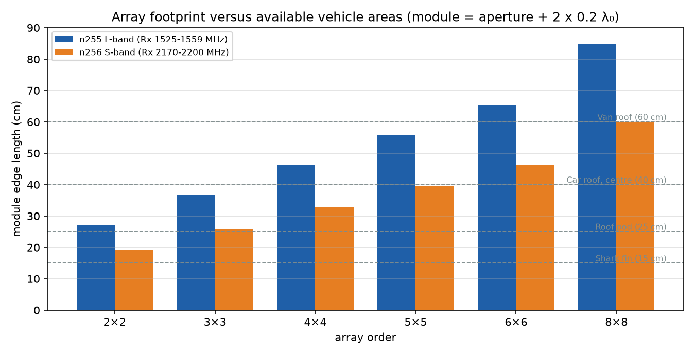
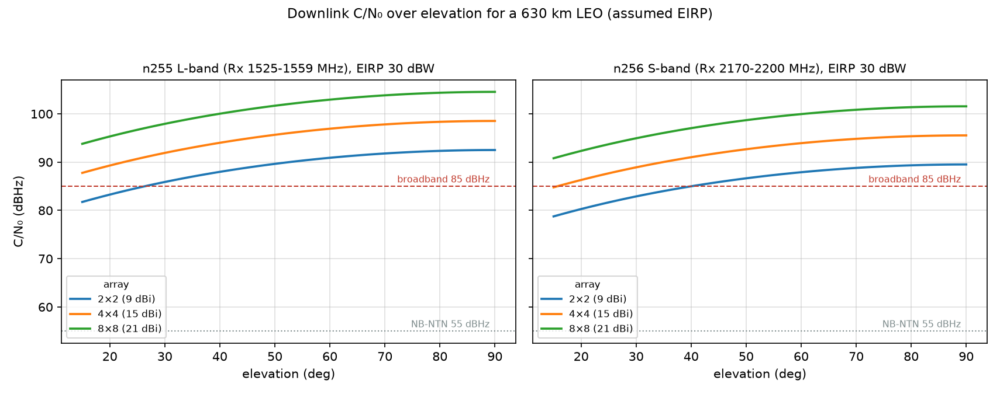
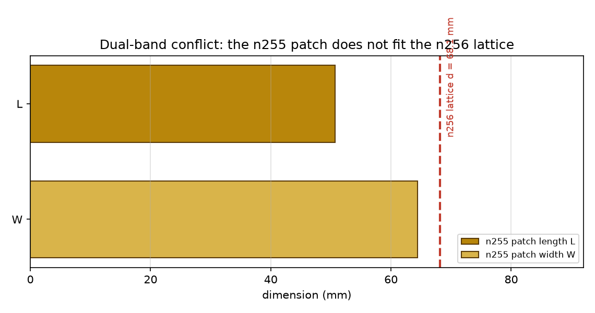

<h1 align="center">Automotive NTN UE Antenna Sizing Study</h1>

<p align="center">
  <em>How large does a 3GPP n255 (L-band) / n256 (S-band) patch array become
  on a vehicle – and is that size realistic?</em>
</p>

<p align="center">
  
  
  
</p>

---

## Overview

A packaging question, answered analytically: how much roof area does an
electronically steered patch array need for an automotive 3GPP NTN user
terminal, and does it fit a passenger car?  No FDTD run is required for this
decision – the chain is substrate and band → patch dimensions (Hammerstad) →
λ/2 lattice → aperture directivity → feed/scan losses → downlink C/N₀.

| Band | Rx | Tx | Patch (L × W) | Lattice λ/2 |
|---|---|---|---|---|
| n255 L-band | 1525–1559 MHz | 1626.5–1660.5 MHz | 50.7 × 64.4 mm | 96.1 mm |
| n256 S-band | 2170–2200 MHz | 1980–2010 MHz | 36.0 × 45.5 mm | 68.1 mm |

Substrate: Rogers RO4003C (εr = 3.55, tan δ = 0.0027), h = 3.05 / 1.52 mm.

## Key results

| Array | n255 module | n255 gain | n256 module | n256 gain |
|---|---|---|---|---|
| 2×2 | 27 cm | 9.4 dBi | 19 cm | 9.4 dBi |
| 3×3 | 37 cm | 12.9 dBi | 26 cm | 13.0 dBi |
| 4×4 | 46 cm | 15.4 dBi | 33 cm | 15.5 dBi |
| 5×5 | 56 cm | 17.4 dBi | 40 cm | 17.4 dBi |
| 8×8 | 85 cm | 21.4 dBi | 60 cm | 21.5 dBi |

Module = aperture + 2 × 0.2 λ₀ for housing and ground-plane margin; gain is
broadside with 1.5 dB feed loss.

**Packaging verdict**

| Installation area | n255 | n256 |
|---|---|---|
| Shark fin (15 × 10 cm) | – | – |
| Roof pod (25 × 25 cm) | – (needs 27 cm) | 2×2 |
| Car roof centre (40 × 40 cm) | 3×3 | 5×5 |
| Van roof (60 × 40 cm) | 3×3 | 5×5 |

<p align="center">
  
</p>

**Link budget** (630 km LEO, EIRP 30 dBW placeholder, 1.5 dB NF): a 2×2 reaches
85.9 dBHz (n255) and 82.9 dBHz (n256) at 30° elevation – the low-rate NB-NTN
target (55 dBHz) is met with a large margin, and even the 85 dBHz
broadband-class target is reached by 2×2 at n255 and 3×3 at n256.  The
packaging size, not the link, is the binding constraint.

<p align="center">
  
</p>

## Dual-band constraint

n255 and n256 cannot share one aperture: the n255 patch (64 mm wide) is larger
than the n256 lattice cell (68 mm) only marginally, and more importantly each
band is FDD – Tx and Rx together span 8.5 % (n255) and 10.5 % (n256) of the
band centre, while a single-layer patch delivers 3–5 % bandwidth.  Two
separate modules (or a broadband stacked element per band) are the practical
solution.

<p align="center">
  
</p>

## Recommendation

* **n256:** 5×5 on the roof centre (40 cm, 17.4 dBi) or 2×2 in a roof pod
  (19 cm, 9.4 dBi).
* **n255:** 3×3 on the roof centre (37 cm, 12.9 dBi); the 2×2 needs a pod
  larger than 25 cm.
* **Both bands:** two modules side by side rather than one shared aperture.
* **Fallback:** mechanical azimuth rotator + electronic elevation scan reduces
  the aperture needed for the same link margin.

## Repository layout

```
ntn_model.py        bands, substrate, patch/array/link relations, assumptions
sizing.py           runs the study -> docs/figures/fig01..07 + docs/results.json
build_docs.py       builds the English and German ODT reports (+ PDF)
tools/odt_builder.py  minimal ODT writer
docs/figures/       figures 01..07
docs/results.json   every number used in the report
docs/ntn_ue_sizing_en.odt / .pdf   full report, English (primary)
docs/ntn_ue_sizing_de.odt / .pdf   full report, German (secondary)
```

## Reproduction

```powershell
python sizing.py       # figures + results.json
python build_docs.py   # reports EN + DE, plus PDF via LibreOffice
```

All assumptions (bands, platforms, EIRP, noise figure, targets) live in
`ntn_model.py`; changing them and re-running both scripts regenerates
everything, including the reported numbers.

## Limitations

* The satellite EIRP is a **placeholder**; the required-array-size curve
  (Figure 6 of the report) must be re-read with operator data.
* Gain is an aperture estimate; mutual coupling, feed-network and radome losses
  need a full-wave run.
* Circular polarisation is not modelled yet (it changes the element design and
  costs about 0.5 dB).
* The vehicle body is a large ground plane; a finite-roof model should quantify
  pattern and back-lobe changes.

---

## Kurzfassung (Deutsch)

Diese Studie beantwortet die Packaging-Frage für ein automotive NTN-Endgerät in
den 3GPP-Bändern **n255** (L-Band, Rx 1525–1559 MHz) und **n256** (S-Band,
Rx 2170–2200 MHz): Wie groß wird ein elektronisch geschwenktes Patch-Array und
passt es auf ein Fahrzeug?

**Ergebnis:** Das n255-Patch misst 50,7 × 64,4 mm bei 96,1 mm Raster, das
n256-Patch 36,0 × 45,5 mm bei 68,1 mm Raster.  Ein 2×2-Modul braucht 27 cm
(n255) bzw. 19 cm (n256); 4×4 bereits 46 cm bzw. 33 cm.

**Einbau:** n256 passt mit 2×2 in ein 25-cm-Dachmodul und mit 5×5 in die
40-cm-Dachmitte.  n255 ist eng: 2×2 braucht 27 cm (mehr als ein 25-cm-Modul),
3×3 passt in die Dachmitte.

**Link-Budget:** Mit dem Platzhalter-EIRP von 30 dBW erreicht schon 2×2 bei
30° Elevation 85,9 dBHz (n255) bzw. 82,9 dBHz (n256) – das NB-NTN-Ziel von
55 dBHz ist mit großer Reserve erfüllt.  Begrenzend ist die Bauform, nicht der
Link.

**Dualband:** n255 und n256 können sich keine Apertur teilen (Frequenzverhältnis
1,42; Tx+Rx spannen 8,5 % bzw. 10,5 %).  Zwei getrennte Module sind die
praktikable Lösung.

Die vollständigen Berichte liegen als `docs/ntn_ue_sizing_en.odt` (Englisch,
Hauptsprache) und `docs/ntn_ue_sizing_de.odt` (Deutsch) samt PDF vor.

---

## License and reuse

© 2026 Michael T. All rights reserved. The material in this repository
(source code, models, data, figures and documents) is published for viewing
and evaluation only. Any reuse, modification, redistribution or publication,
in whole or in part, requires prior written permission from the author.
See [LICENSE](LICENSE).

**Weiternutzung:** Alle Inhalte dieses Repositories sind ausschließlich zur
Einsicht und Bewertung veröffentlicht. Jede Weiternutzung – auch auszugsweise –
bedarf der vorherigen schriftlichen Genehmigung des Urhebers (siehe
[LICENSE](LICENSE)).
